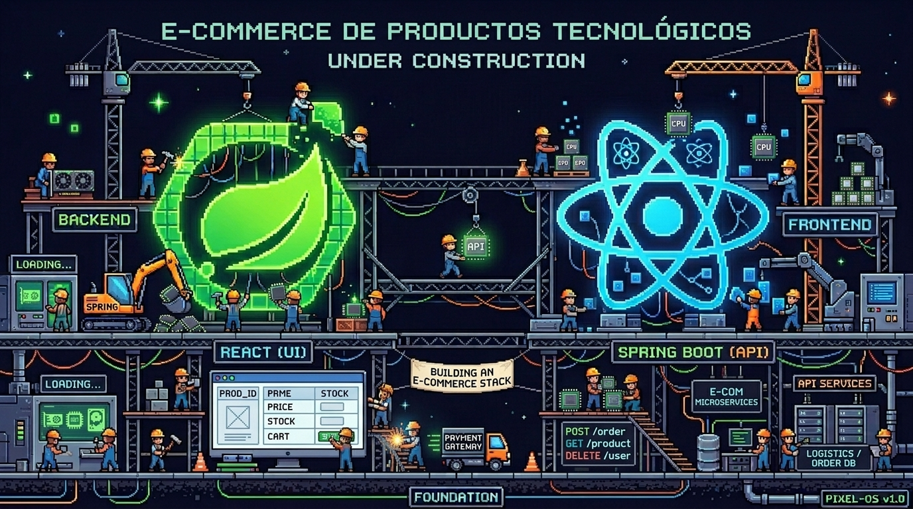

  

# E-commerce de productos tecnológicos

Plataforma de comercio electrónico dedicada a la venta de productos tecnológicos y electrónicos, que abarca una amplia variedad de artículos, desde componentes electrónicos como transistores hasta equipos informáticos, monitores, impresoras y otros productos relacionados con la tecnología.

## Stack tecnológico

  
  
  
  
  
  
  

